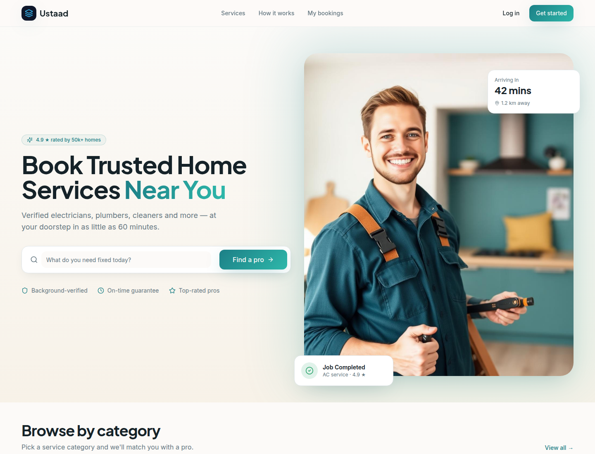
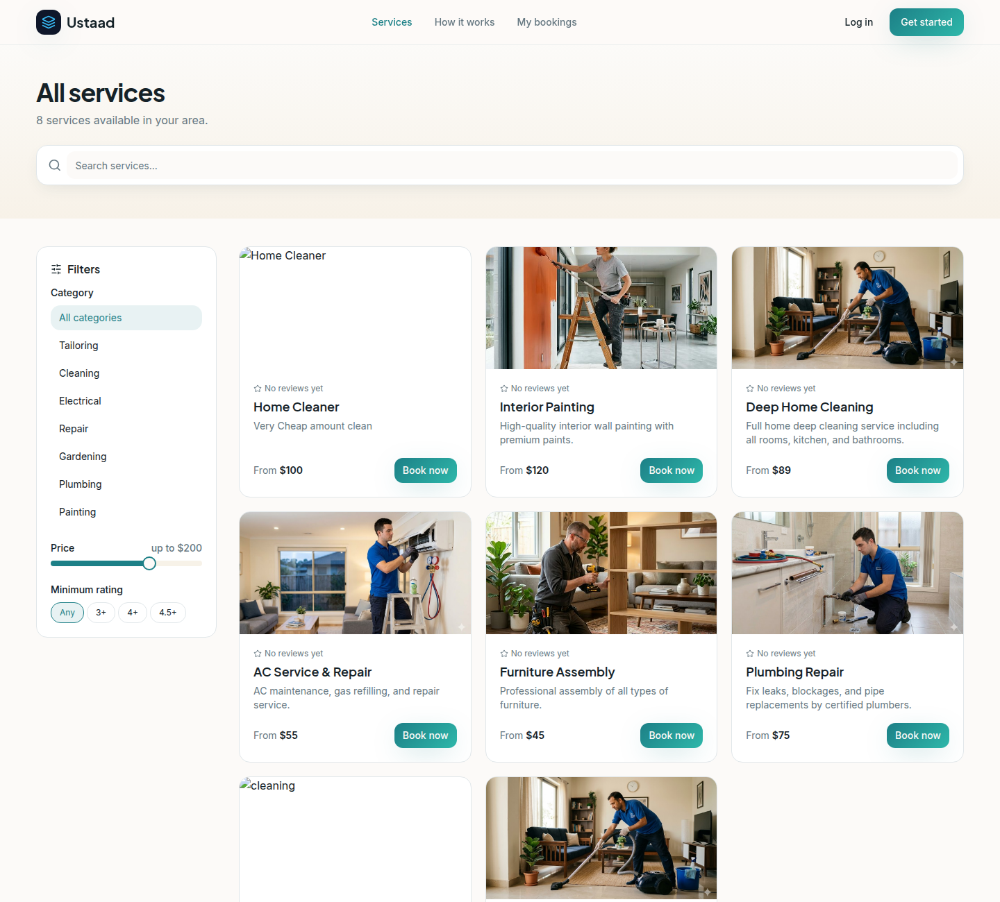
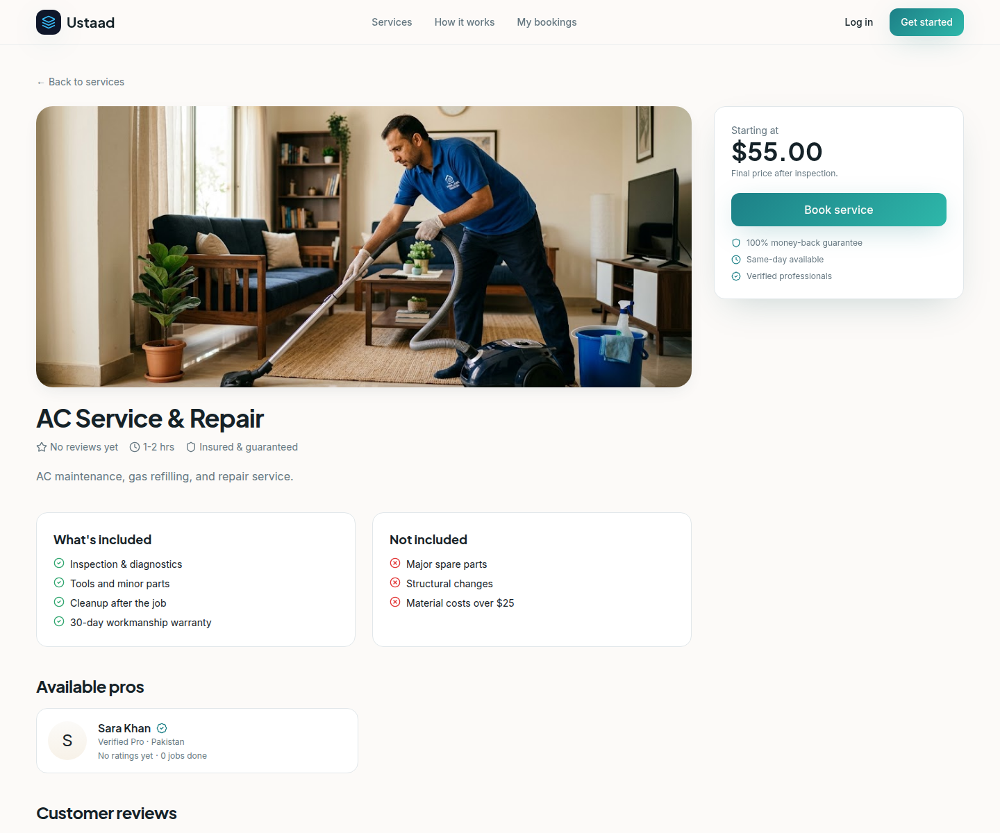
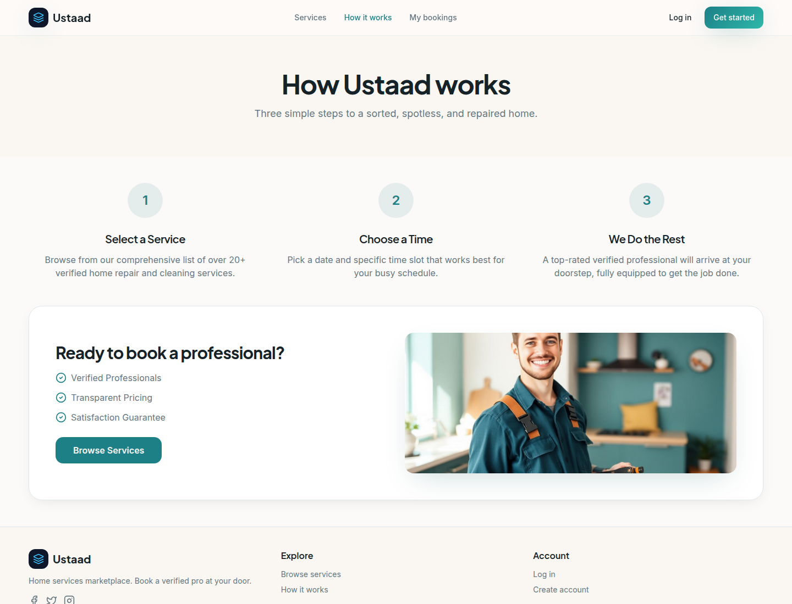
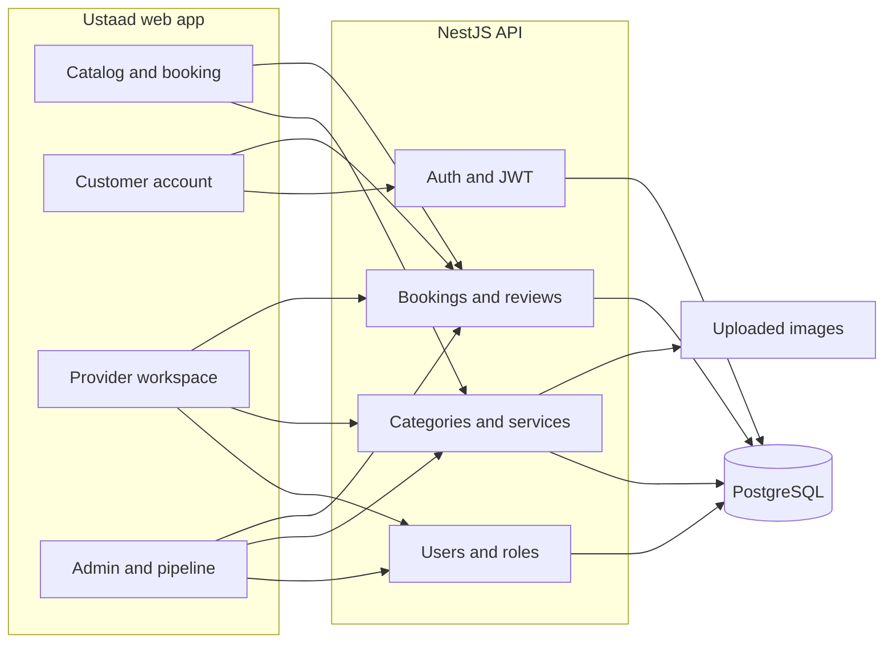

# Ustaad

**Home services marketplace for booking verified local pros.**

Ustaad is where a household books a skilled pro for the job at the door. People browse a live catalog — cleaning, electrical, plumbing, painting, repair, and more — pick a date and a time, and send the request to a provider. Providers list what they offer and work the jobs assigned to them. Admins keep the catalog honest: they approve new pros and listings, and they follow every booking through to a review.

The name is the everyday word for a master craftsperson. The product is that marketplace, not a sync tool.

**Live demo:** [ustaad-services.vercel.app](https://ustaad-services.vercel.app)

The screenshots below are the public pages — home, catalog, a service, and how booking works — with the live catalog behind them.

## Screenshots

### Home

### Catalog

### A service

### How it works

## What you can do

**Households**

- Search the catalog and filter by category, price ceiling, and minimum rating. Ratings come from customer reviews on completed bookings.
- Open a service for the scope, the starting price, and the pro attached to that listing.
- Book a date and a time slot, with address, city, phone, notes, and a choice of online or cash. A visit fee is added to the quoted price.
- Track bookings by status, open a booking, and leave a star rating and a written review after the job is completed.
- Update a profile. Contact details from the profile are filled in on the next booking.

**Providers**

- Sign up to offer services. A new provider account stays pending until an admin approves it, and a rejected account cannot publish work.
- See assigned jobs, today's schedule, and completed earnings for the month.
- Move a job's status, and edit the services they offer.
- Set working days, hours, a break, and whether they are accepting new jobs.
- Keep a public profile: trade, service area, bio, and years of experience.

**Admins**

- See customer, provider, booking, and catalog counts, plus booking volume and status mix.
- Create and edit categories, and turn a category on or off.
- Approve, reject, edit, or remove services.
- Approve or reject provider accounts.
- Update or remove bookings, and hide a review that should not stay public.
- Read the same bookings as a pipeline: new, contacted, qualified, won, and lost, with follow-ups for open jobs. Those stages are the booking statuses, shown for operations. The separate report charts on that screen are sample figures, not live totals.

## Architecture

The browser app talks to the [NestJS API](https://github.com/maarijwaseem2/servicesync-pro-backend) over JSON. Signed-in requests carry a bearer token. The API stores users, categories, services, and bookings in PostgreSQL, and serves uploaded service images as static files.

Roles are customer, provider, and admin. A provider only sees their own jobs. A customer only sees their own bookings. Admins see the full catalog and every booking.

## Tech stack

| Layer | Choices |
| --- | --- |
| Web app | React 18, TypeScript, Vite, React Router |
| Data on the client | TanStack Query, Axios |
| Interface | Tailwind CSS, Radix UI, Lucide |
| Forms and charts | React Hook Form, Zod, Recharts |
| API | NestJS, Passport JWT, class-validator |
| Data | PostgreSQL, TypeORM |
| Account security | bcrypt hashes, checked on the API |

## Roadmap

- Charge the online option through a payment provider. The booking stores the method today. It does not take a card.
- Send a real reset message from the account-recovery screen. The screen is in the product. It does not contact the API yet.
- Draw the pipeline reports from live bookings instead of the sample series.
- Add an in-progress status on the API so the steps on a booking match the statuses the server accepts. The server currently uses pending, confirmed, completed, and cancelled.
- Keep the operations pipeline on the same admin session as the rest of the console.

## Author

**Syed Abdul Maarij**

- GitHub: [maarijwaseem2](https://github.com/maarijwaseem2)
- Portfolio: [own-showcase.vercel.app](https://own-showcase.vercel.app)
